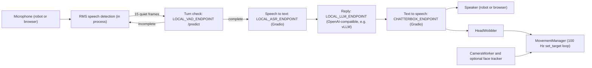

# Reachy Mini conversation app

A voice conversation app for the Reachy Mini robot that runs on self-hosted services instead of the OpenAI realtime API, so no OpenAI key is needed. The four services are a turn-detection server, a Gradio speech-to-text app, an OpenAI-compatible LLM server such as vLLM, and Chatterbox text to speech with voice cloning. On the robot side it keeps upstream's 100 Hz motion loop, which blends speech-reactive head wobble with optional YOLO or MediaPipe face tracking, plus optional on-device vision with SmolVLM2.

At HEAD (`27ddec4`) the voice loop chains all four services. Tool calling did not survive the switch, so the conversation cannot trigger the dance, emotion, camera or head-tracking tools, and local vision descriptions are logged but never reach the LLM.

> [!NOTE]
> This repository is a fork of [muellerzr/reachy_mini_conversation_app](https://github.com/muellerzr/reachy_mini_conversation_app), which builds on Pollen Robotics' [reachy_mini_conversation_app](https://github.com/pollen-robotics/reachy_mini_conversation_app). Apart from this README, every commit here comes from upstream or from Zach Mueller. Two of my own public Reachy Mini projects draw on the upstream app instead; see [Related projects](#related-projects).

## What this fork changes

The history up to commit `c1d6d45` (2025-12-17) is upstream work by Pollen Robotics and Hugging Face contributors. Zach Mueller's four commits on top (2025-12-21 to 2025-12-22, ending at `27ddec4` "Zero openai version") make these changes:

- Replace the OpenAI realtime handler with `LocalRealtimeHandler` in `src/reachy_mini_conversation_app/openai_realtime.py` (the old `OpenaiRealtimeHandler` name stays as an alias). It talks to four services configured through `LOCAL_VAD_ENDPOINT`, `LOCAL_ASR_ENDPOINT`, `LOCAL_LLM_ENDPOINT` and `CHATTERBOX_ENDPOINT` (see [Configuration](#configuration)).
- Remove the OpenAI API key flow from console mode (key download, key validation and the key settings endpoints in `console.py`).
- Split text for speech into chunks of about 150 characters at sentence, clause, phrase or word boundaries, so the first chunk can play before the whole reply is synthesized.
- Rename the default persona to "Alfred" and add `alfred_1_isolated.wav` as the default voice-cloning reference clip.
- Add [vad_server_layout.md](vad_server_layout.md), reference code for a Flask turn-detection server that runs the smart-turn v3.1 ONNX model.

The switch dropped tool calling. The local LLM request sends no tool schemas and the handler never calls `dispatch_tool_call`, so the dance, emotion, camera and head-tracking tools are loaded but nothing in the conversation can trigger them.

## Architecture

At HEAD, one conversational turn flows through the handler like this:



Speech starts once the RMS level stays above 0.01 for 5 frames. After 15 quiet frames the buffered audio goes to the turn-detection server as a base64 WAV. If the server says the turn is incomplete, the app keeps listening; if the request fails, it treats the turn as complete. The LLM sees the profile instructions plus the last 20 messages, and any `<think>...</think>` block is stripped before synthesis. Each speech chunk is resampled to 24 kHz when needed, fed to the head wobbler, and queued in 200 ms pieces.

The upstream architecture diagram ([docs/scheme.mmd](docs/scheme.mmd), Mermaid source) shows the original OpenAI realtime design with tool calls.

## Features

- Voice loop built on `fastrtc` that chains the four self-hosted services above.
- Optional local vision: with `--local-vision`, SmolVLM2 runs on-device (MPS, CUDA or CPU) and describes the latest camera frame every 5 seconds. At HEAD those descriptions are only logged at debug level and are not passed to the LLM.
- Layered motion system that queues primary moves (dances, emotions, goto poses, breathing) while blending speech-reactive wobble and face tracking. Dances and emotions are queued by tools, so at HEAD a conversation only drives idle breathing, speech wobble and (with `--head-tracker`) face tracking.
- Gradio web UI with live transcripts of both sides of the conversation and a personality editor.

## Installation

> [!IMPORTANT]
> Before using this app, you need to install [Reachy Mini's SDK](https://github.com/pollen-robotics/reachy_mini/).<br>
> Windows support is experimental and has not been extensively tested.

You also need the four services running somewhere the app can reach. This repo does not include them, apart from the reference turn-detection server code in [vad_server_layout.md](vad_server_layout.md).

### Using uv

Set up the project with [uv](https://docs.astral.sh/uv/):

```bash
uv venv --python 3.12.1  # Create a virtual environment with Python 3.12.1
source .venv/bin/activate
uv sync
```

> [!NOTE]
> To reproduce the exact dependency set from this repo's `uv.lock`, run `uv sync` with `--locked` (or `--frozen`). `uv` then installs straight from the lockfile without re-resolving or updating any versions.

To include optional dependencies:

```bash
uv sync --extra reachy_mini_wireless # For wireless Reachy Mini with GStreamer support
uv sync --extra local_vision         # For local PyTorch/Transformers vision
uv sync --extra yolo_vision          # For YOLO-based vision
uv sync --extra mediapipe_vision     # For MediaPipe-based vision
uv sync --extra all_vision           # For all vision features
```

Extras combine, and you can add the dev dependencies too:

```bash
uv sync --extra all_vision --group dev
```

### Using pip

```bash
python -m venv .venv # Create a virtual environment
source .venv/bin/activate
pip install -e .
```

Install optional extras for the features you need:

```bash
# Wireless Reachy Mini support
pip install -e .[reachy_mini_wireless]

# Vision stacks (choose at least one if you plan to run face tracking)
pip install -e .[local_vision]
pip install -e .[yolo_vision]
pip install -e .[mediapipe_vision]
pip install -e .[all_vision]        # installs every vision extra
```

The development tools live in a uv dependency group, not a pip extra. With pip, install them directly:

```bash
pip install pytest pytest-asyncio ruff==0.12.0 mypy==1.18.2 pre-commit types-requests
```

Some wheels (PyTorch, for example) are large and need CUDA or CPU builds that match your platform, so check the binaries each extra pulls in.

### Optional dependency groups

| Extra | Purpose | Notes |
|-------|---------|-------|
| `reachy_mini_wireless` | Wireless Reachy Mini with GStreamer support. | Required for wireless versions of Reachy Mini, includes GStreamer dependencies. |
| `local_vision` | Run the local VLM (SmolVLM2) through PyTorch/Transformers. | GPU recommended; needs a PyTorch build that matches your platform. |
| `yolo_vision` | YOLO face detection via `ultralytics` and `supervision` (model `AdamCodd/YOLOv11n-face-detection`). | Supports the `--head-tracker yolo` option. |
| `mediapipe_vision` | Lightweight landmark tracking with MediaPipe. | Works on CPU; enables `--head-tracker mediapipe`. |
| `all_vision` | Convenience alias installing every vision extra. | Use it to try every provider. |
| `dev` (uv group) | Developer tooling (`pytest`, `pytest-asyncio`, `ruff`, `mypy`, `pre-commit`). | `uv sync --group dev`; see above for pip. |

## Configuration

Copy `.env.example` to `.env`, then add the four endpoint variables below. `.env.example` still carries the upstream `OPENAI_API_KEY` and `MODEL_NAME` entries and does not list the local endpoints yet. At HEAD only a leftover key textbox in `--gradio` mode reads `OPENAI_API_KEY`, and it has no effect.

| Variable | Description |
|----------|-------------|
| `LOCAL_VAD_ENDPOINT` | Required. Base URL of the turn-detection server. The app POSTs `{"audio_base64": ...}` to `/predict` and reads `prediction` (1 means the turn is complete). Reference server: [vad_server_layout.md](vad_server_layout.md). |
| `LOCAL_ASR_ENDPOINT` | Required. Gradio app whose first function takes an audio file and returns the transcript as a string. |
| `LOCAL_LLM_ENDPOINT` | Required. OpenAI-compatible base URL ending in `/v1`, for example a vLLM server. |
| `LOCAL_LLM_MODEL` | Model name served at that endpoint. Defaults to `Qwen3-30B`. |
| `CHATTERBOX_ENDPOINT` | Required. Gradio app running Chatterbox TTS; the app calls `fn_index=9` with the text, a reference clip and sampling settings. |
| `CHATTERBOX_REF_AUDIO` | Optional reference clip for voice cloning. Without it, a source checkout falls back to `alfred_1_isolated.wav` at the repo root. |
| `HF_HOME` | Cache directory for local Hugging Face downloads (only used with `--local-vision` flag, defaults to `./cache`). |
| `HF_TOKEN` | Optional token for Hugging Face models (falls back to `huggingface-cli login`). |
| `LOCAL_VISION_MODEL` | Hugging Face model path for local vision processing (only used with `--local-vision` flag, defaults to `HuggingFaceTB/SmolVLM2-2.2B-Instruct`). |
| `REACHY_MINI_CUSTOM_PROFILE` | Profile to load (see [Using custom profiles](#using-custom-profiles)). `.env.example` sets it to `example`; remove the line to use the default profile. |

If any of the four required endpoints is missing, the handler logs `Cannot start: missing required local endpoints` and ignores microphone input.

## Running the app

Activate your virtual environment, make sure the Reachy Mini robot (or simulator) is reachable, then launch:

```bash
reachy-mini-conversation-app
```

By default the app runs in console mode for direct audio interaction. The `--gradio` flag launches a web UI served locally at http://127.0.0.1:7860/, which simulation mode requires. With a camera attached, the camera worker buffers frames; face tracking runs only when you pass `--head-tracker yolo` or `--head-tracker mediapipe` and have installed the matching extra. The `--local-vision` flag adds periodic SmolVLM2 descriptions of the camera frame.

### CLI options

| Option | Default | Description |
|--------|---------|-------------|
| `--head-tracker {yolo,mediapipe}` | `None` | Select a face-tracking backend when a camera is available. YOLO is implemented locally, MediaPipe comes from the `reachy_mini_toolbox` package. Requires the matching optional extra. |
| `--no-camera` | `False` | Run without camera capture or face tracking. |
| `--local-vision` | `False` | Run the local vision model (SmolVLM2) on a camera frame every 5 seconds. Requires `local_vision` extra to be installed. |
| `--gradio` | `False` | Launch the Gradio web UI. Without this flag, runs in console mode. Required when running in simulation mode. |
| `--debug` | `False` | Enable verbose logging for troubleshooting. |
| `--wireless-version` | `False` | Use the WebRTC media backend for the wireless version of the robot. Requires `reachy_mini_wireless` extra to be installed. |
| `--on-device` | `False` | Combined with `--wireless-version`, use the GStreamer backend when the app runs on the same device as the Reachy Mini daemon. |

### Examples

```bash
# Hardware with MediaPipe face tracking
reachy-mini-conversation-app --head-tracker mediapipe

# Local vision processing (requires the local_vision extra)
reachy-mini-conversation-app --local-vision

# Wireless support (requires the reachy_mini_wireless extra and a daemon started with --wireless-version)
reachy-mini-conversation-app --wireless-version

# On the wireless robot itself, using the GStreamer backend
reachy-mini-conversation-app --wireless-version --on-device

# Audio-only conversation with the camera pipeline disabled
reachy-mini-conversation-app --no-camera
```

### Troubleshooting

This error usually means the Reachy Mini daemon is not running:

```text
TimeoutError: Timeout while waiting for connection with the server.
```

Install [Reachy Mini's SDK](https://github.com/pollen-robotics/reachy_mini/) and start the daemon.

If the robot does not reply after you speak, check the log for `Cannot start: missing required local endpoints`, `VAD check failed`, `Local ASR transcription failed` or `Local LLM generation failed`. Each one points at the service that is unset or unreachable.

## Tool library

These tools ship in `src/reachy_mini_conversation_app/tools/` and are enabled per profile through `tools.txt`. Upstream exposed them to the realtime model. At HEAD of this fork the registry and dispatcher in `tools/core_tools.py` still load them per profile, but the local LLM path does not call them (see [What this fork changes](#what-this-fork-changes)).

| Tool | Action | Dependencies |
|------|--------|--------------|
| `move_head` | Queue a head pose change (left/right/up/down/front). | Core install only. |
| `camera` | Capture the latest camera frame. Returns a SmolVLM2 description when `--local-vision` is on, otherwise a base64 JPEG. | Requires camera worker. |
| `head_tracking` | Enable or disable face-tracking offsets (detects and follows face position; no facial recognition). | Camera worker with configured head tracker. |
| `dance` | Queue a dance from `reachy_mini_dances_library`. | Core install only. |
| `stop_dance` | Clear queued dances. | Core install only. |
| `play_emotion` | Play a recorded emotion clip via Hugging Face assets. | Needs `HF_TOKEN` for the recorded emotions dataset. |
| `stop_emotion` | Clear queued emotions. | Core install only. |
| `do_nothing` | Explicitly remain idle. | Core install only. |

## Using custom profiles

A profile pairs a prompt with a set of enabled tools. Set `REACHY_MINI_CUSTOM_PROFILE=<name>` to load `src/reachy_mini_conversation_app/profiles/<name>/` (see `.env.example`). If it is unset, the `default` profile is used.

Each profile needs two files, `instructions.txt` (prompt text) and `tools.txt` (list of allowed tools), and can also hold custom tool implementations.

### Custom instructions

Write plain-text prompts in `instructions.txt`. To reuse shared prompt pieces, add lines like:

```text
[passion_for_lobster_jokes]
[identities/witty_identity]
```

Each placeholder pulls the matching file under `src/reachy_mini_conversation_app/prompts/` (nested paths allowed). See `src/reachy_mini_conversation_app/profiles/example/` for a reference layout.

### Enabling tools

List enabled tools in `tools.txt`, one per line, and prefix a line with `#` to comment it out:

```text
play_emotion
# move_head

# My custom tool defined locally
sweep_look
```

Tools resolve first from Python files in the profile folder (custom tools), then from the shared library `src/reachy_mini_conversation_app/tools/` (e.g., `dance`, `head_tracking`).

### Custom tools

To add a tool for one profile, put a Python file in that profile's folder. Custom tools must subclass `reachy_mini_conversation_app.tools.core_tools.Tool` (see `profiles/example/sweep_look.py`).

### Edit personalities from the UI

When running with `--gradio`, use the personality controls in the web UI:

- Pick a profile in "Select personality" (folders under `src/reachy_mini_conversation_app/profiles/`, including `user_personalities/`) or the built-in default.
- Click "Apply personality" to switch instructions for the next LLM request. This also clears the conversation history.
- Click "New personality", fill in a name, instructions and `tools.txt`, then save. Files are written to `profiles/user_personalities/<name>/`.

In console mode run as a Reachy Mini app, the settings page served from `static/index.html` offers the same actions plus "Use on startup", which stores the choice as `REACHY_MINI_CUSTOM_PROFILE` in the instance `.env`.

Applying a personality changes the conversation instructions only. Tool sets load at startup from `tools.txt` and are not hot-reloaded, and the "Voice" selector has no effect with Chatterbox, which takes its voice from the reference clip.

## Development workflow

Install the dev group with `uv sync --group dev` (pip users: see [Using pip](#using-pip)), then lint, type-check and test:

```bash
ruff check .   # lint
mypy .         # type-check (configured in pyproject.toml)
pytest         # test suite
```

`tests/test_openai_realtime.py` has a few unit tests for the local handler (alias, readiness check, timestamp, voices, personality switch) that need no live services; it does not exercise the VAD, ASR, LLM or TTS calls. `tests/audio/test_head_wobbler.py` tests the speech wobble worker's reset behaviour. The upstream GitHub Actions workflows in `.github/workflows/` run ruff, pytest and mypy.

When iterating on robot motions, keep blocking work out of the 100 Hz control loop in `moves.py` so it stays responsive.

## Related projects

Two of my public Reachy Mini projects draw on the upstream app rather than on this fork's code. [DnD_Familia_Reachy](https://github.com/TirtheshJani/DnD_Familia_Reachy) runs Pollen's unmodified conversation app on the robot and points it, through a local `speech-to-speech` server, at a local LLM "brain" service. [rocky_mini](https://github.com/TirtheshJani/rocky_mini) is a separate app that copies patterns studied in the official app, such as the layered movement manager and the head-wobbler delay.

## License

Apache 2.0, see [LICENSE](LICENSE). The app is by Pollen Robotics and Hugging Face contributors; the switch to self-hosted services is by Zach Mueller.
